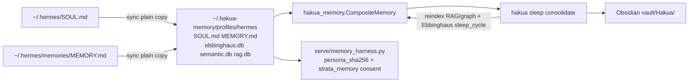

# 実装ログ: Hakua↔Hermes SOUL/Memory 配線 + RAG/Graph/Ebbinghaus/Obsidian/Sleep

- **日付**: 2026-10-29 JST
- **実装AI**: Cursor
- **ブランチ**: `feat/hakua-hermes-memory-stack`
- **口調メモ**: なんj風で残す — ようやく記憶の本線が一本にまとまったで、バラバラの md 放置は終わりや。

## 概要

Hermes Agent の `SOUL.md` / `MEMORY.md` を **Hakua consented memory**（`serve/memory_harness.py` の principal root + `persona_sha256`）へ配線し、既存の `hakua_memory` パッケージ（Ebbinghaus / Semantic Graph / RAG / Obsidian / sleep）を垂直スライスで Strata から叩けるようにした。

## 背景・要求

- Hermes の人格・長期メモがローカル md だけで死蔵され、Hakua harness と切れていた。
- ユーザー要求: RAG+意味グラフ、Ebbinghaus、Obsidian 双方向/一方向、sleep 統合、principal 鍵・同意メモリ遵守。

## 前提・判断

| 判断 | 内容 |
|------|------|
| SoT | 既定は Hakua profile `~/.hakua-memory/profiles/hermes/`（`HAKUA_MEMORY_SOT=hakua`）。Hermes 側はアダプタ同期。 |
| リンク禁止 | harness が symlink/hardlink を拒否するため、常に plain byte-copy。 |
| 依存 | 新規 pip は足さず、PC 上の `hakua_memory`（CompositeMemory）+ stdlib。 |
| 秘密 | API 鍵は `key_env` のみ。例示 JSON に実キーなし。 |
| cherry-pick | `ec950a31` の Memory 統合は既に tip に MCP/Host bridge として存在。スタック層を加算。 |

## データフロー



## 変更ファイル

- `tools/hakua_hermes_memory_stack.py` — スタック本体（sync / remember / recall / reindex / obsidian / sleep / harness-snippet）
- `tools/strata_memory_mcp.py` — スタック委譲（status / remember / sleep）
- `tests/test_hakua_hermes_memory_stack.py` — GPU なし 4 件
- `serve/examples/hakua_hermes_harness.example.json` — harness 有効化テンプレ
- Hermes プラグイン `plugins/hermes-strata/core.py`（agent リポ + `~/.hermes`）— profile 優先パス

## 有効化手順

```powershell
# 1) Hermes → Hakua profile へ同期し persona_sha256 を得る
py -3 tools/hakua_hermes_memory_stack.py sync
py -3 tools/hakua_hermes_memory_stack.py harness-snippet

# 2) sleep（RAG 再index + Ebbinghaus + Obsidian flush）
py -3 tools/hakua_hermes_memory_stack.py sleep
# または MCP / Host:
py -3 tools/strata_memory_mcp.py --cli sleep

# 3) サーバー設定に users[] を貼り、HAKUA_HERMES_KEY を既存 ASCII api_key に設定
#    hakua_harness.enabled=true は --prompt-cache 0 --conversation-cache-mib 0 必須
#    クライアントは strata_memory:{read,store_summary,turn_id} を明示同意
```

環境変数: `HERMES_HOME`, `HAKUA_MEMORY_HOME`, `HAKUA_HERMES_PRINCIPAL`, `HAKUA_HERMES_PROFILE`, `HAKUA_MEMORY_SOT`, `OBSIDIAN_VAULT_PATH`.

## 検証

```text
py -3 -m unittest tests.test_hakua_hermes_memory_stack -v
→ 4 tests OK (forgetting curve / sync / remember+recall+sleep+obsidian / path resolve)
```

## 残留リスク

- 本番 multiuser の native cache 切替は upstream MEMORY_HARNESS.md 通り未検証 → harness は opt-in のまま。
- Obsidian import は vault `Hakua/MEMORY.md` を条件付きで取り込むのみ（衝突時は SOT 優先）。
- Hermes 本体リポ外の `core.py` 変更は Strata コミットに含まれない（本機プラグイン更新済み）。

## 次の推奨アクション

- オペレータが実キーで harness を enable し、同意付き 1 往復スモーク。
- Release パイプラインで製品バージョンに本配線を含める。
