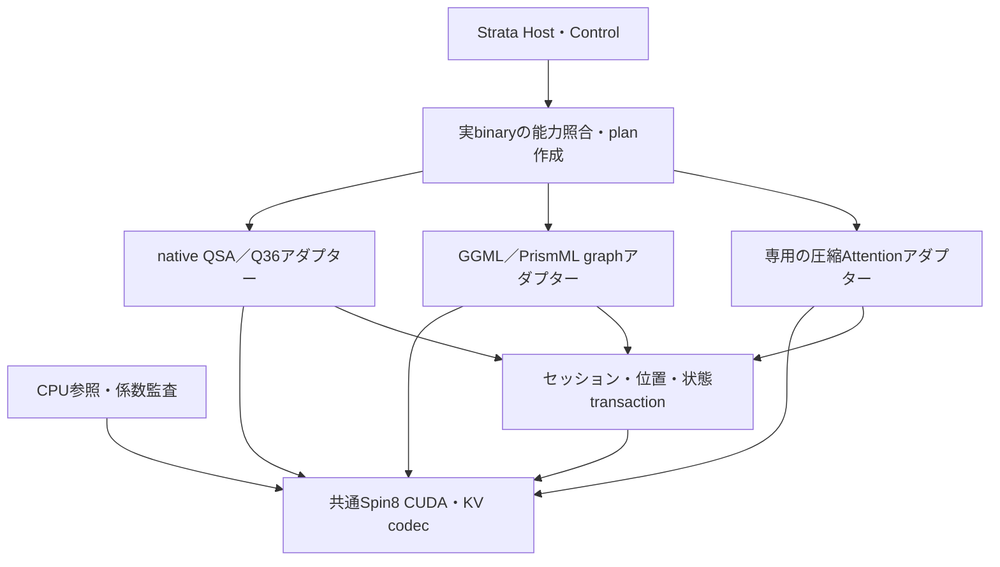

# Strata：複数LLMに共通化するSpin(8) CUDA 13.5バックエンド実装計画

**改訂第2版・2026-11-06（日本時間）**
調査対象：`zapabob/Strata`、固定コミット `c50ca06a863a98ff121cbff30365a035a90205e2`。
対象環境：Windows 11 x64、RTX 5060 Ti 16 GB、RAM 32 GB、CUDA 13.5。
文書の状態：ソース調査・設計・CPU数値検証。汎用CUDAエンジンの実装完了、GPU動作、実モデル品質・性能の認定を示すものではない。

## 1. 改訂の結論

Spin(8)の計算をモデルに依存しないライブラリに置き、**モデルごとのAttentionの意味を宣言するアダプター**と、**キャッシュ・再帰状態を所有するセッション管理**を接続する。Qwen3.6専用の改造を全モデルへコピーする構成から、native StrataとGGML／llama.cpp／PrismMLに共通の数値コアを提供する構成へ改訂する。

汎用化の対象は、最初に既存runtimeが読み込めるモデルとそのAttentionである。新しいGGUF architectureのローダー、重み形式、MoEのexpert処理まで一度に新規実装する必要はない。ただし、**モデルをロードできること、Spin8のフックを実行できること、品質・性能まで確認したことは別々に記録する**。

モデルを選ぶと、ロードした実体・層構造・GPU・実行モードから有効なplanを構築する。未対応の層や組合せを、既存のQwen用構造へ無理に当てはめない。以下の機能は独立に選択し、実装・試験済みの組合せだけを許可する。

| 機能 | 再利用できるもの | モデル別に必要なもの | 意味 |
|---|---|---|---|
| 固定Hadamard＋Spin(8)回転 | 係数生成、監査、回転・逆回転kernel | 形状、位置処理、Q/K対応、V復元位置 | 非量子化の厳密演算ではAttentionを保つ座標変換 |
| 回転後のKV量子化 | codec、ページ管理、Attention演算 | calibration、許容誤差、品質・容量評価 | 保存誤差とメモリ／帯域の性質を変える |
| 学習済みQuery-v3 | controllerの実装・sidecar検証 | 対象重み、層、head、適用位置に合う学習済みsidecar | Qを変え、モデルの関数を変える |
| 独立したS+／S−の双線形adapter | triality積の数値実装 | 射影・出力重みの学習と品質評価 | 新しい特徴計算をモデルに追加する |

三つの固定直交座標を用意するだけで、情報量や推論能力が増えるとはしない。量子化なしの同値性、量子化の効果、学習による変化を別々に評価する。

## 2. 現在のStrataと、今回追加する範囲

### 2.1 モデル実行経路の現状

| 実行経路 | 固定コミットで確認した内容 | 汎用化での扱い |
|---|---|---|
| main native・QSA系 | `Qwen4Exp`。geometryやkernelサイズにコンパイル時の固定値が多い | 既存QSA bridgeを一つのアダプターとして残す |
| main native・Qwen3.6系 | `Qwen35Moe`。`strata::qwen35::run()`へ独立分岐 | full-attention用アダプターとGDN状態参加者を追加する |
| 独立したDeepSeek V4.1実装 | `STRATA_BUILD_DSV41`は既定OFF。別実行ファイル`strata-dsv41`のソースがある | main nativeの対応一覧へ自動的に足さない。圧縮・shared-KV・indexer等の専用アダプターを別途評価する |
| Hostが管理するllama.cpp系 | 外部`llama-server`とそのDLL・バージョンを管理する | 当該binaryが読めるarchitectureと重みdialectを利用し、GGML graphへSpin8を接続する |
| Hostが管理するPrismML | Bonsai等の専用重みdialectを含む別runtime | PrismML側のgraph・KV・fusion経路に接続する |

`model_family_runs()`の通常core、Qwen3.6の独立dispatch、optionalなDSV41、外部runtimeを区別する。設定の`qwen`や`supports_spin8=true`という宣言だけから、すべてのQwenモデルや全backendに対応しているとは判断しない。[model_family.hpp][repo-family]、[geometry.hpp][repo-geometry]、[generate.cpp][repo-generate]、[root CMake][repo-cmake]、[外部backend管理][repo-local-backends]。

### 2.2 再利用できる実装と制約

| 部品 | 現在の契約・制約 | 改訂案 |
|---|---|---|
| `spin8/src/spin8.cpp` | 同一Spin(8)要素の三表現を生成・監査 | 数学の共通基準として維持 |
| CPU Attention API | Q/K幅`d`とV幅`dv`を別に渡せる | 汎用CUDA APIの参照契約に利用 |
| `spin8/include/spin8/cuda.h` | 現行AttentionはQ/K/V共通head幅、K/V共通F32またはF16 | 新APIでQ/K幅とV幅、K/V dtype・strideを分離 |
| 回転API | 完全な8要素ブロックを回転し、末尾1〜7要素は恒等 | 任意論理幅の基本規則として再利用 |
| native cache／Turbo codec | head幅128／256、resident、演算F32、Turbo2〜Turbo6、同じK/V幅、固定H128規約 | v1を維持し、別のlayout版・汎用fallback・特殊化kernelを追加 |
| native cache内部のSpin8 | query変換・回転・append・attendを持つ | legacy経路とは別の接続済み範囲として扱う |
| legacy `spin8_attention.cpp` | decode参照、global profile、prefillは従来経路、serve等の制約 | 数値比較用として残し、session型の運用APIへ移す |
| Query-v3 CUDA | 厳密な逐次FP64を多く使う参照実装 | 参照を保存し、入力条件と数値版を持つ高速実装を追加 |
| 外部runtime向けpatch | MHA graphの試作、Qwen35限定のQueryフック、FlashAttentionや量子化KV等の制約 | model別hookとfused／unfused両経路を製品実装へ進める |

根拠：[CPU API][repo-spin-api]、[CUDA API][repo-cuda-api]、[native設定][repo-config]、[cache CUDA API][repo-cache-api]、[native runtime][repo-runtime]、[Query-v3 CUDA][repo-qv3-cuda]、[Prism graph patch][repo-prism-graph]、[Prism Query patch][repo-prism-query]。

既存native cacheの幅チェックを外すだけでは一般化にならない。kernel内の固定サイズ配列、H128、arena、量子化blockの前提を同時に扱う必要がある。

## 3. 共通コアとモデルアダプターの境界



共通ライブラリはモデル名や`ModelGeometry`、QSAのstep配列、GDN、GGUFのtensor名を解釈しない。アダプターがそれらを読み、共通descriptorへ変換する。モデル固有のRoPE、normalization、mask生成、gate、出力投影を保ち、数値コアへは意味が確定した入力を渡す。

### 3.1 層ごとのAttention契約

一つのモデル全体にhead幅や位置方式を一つだけ持たせず、**各層について**以下を宣言する。

| 分類 | 必須の情報 |
|---|---|
| 層と演算種別 | logical layer ID、標準Attention／局所Attention／cross-attention／latent・shared-KV／再帰状態 |
| 形状 | `n_q_heads`、`n_k_heads`、`n_v_heads`、`d_qk`、`d_v`、明示的なQ→K/V head対応表 |
| tensor | dtype、device、shape、byte stride、alignment、buffer容量、読み書き範囲 |
| 前処理と位置 | Q/K normの有無・位置、RoPE方式・回転幅・scaling・多軸位置、position contract ID |
| 系列identity | query側とKV source側のsequence ID・位置・source mask。cross-attentionではencoder入力／結果のidentity |
| score | 元モデルのscale、bias、softcapの順序とパラメータ、追加のlearned sink等 |
| 可視範囲 | causal、local window、prefix、cross-attention、ragged、padding、全要素masked時の規則 |
| 出力 | V逆変換位置、gateの有無と位置、出力projectionへ渡すlayout |
| 保存 | K/V別codec、logical／stored幅、block、scale、tail、page／ring layout、format version、cache group／alias identity |

初期の標準Attention実装では`n_k_heads=n_v_heads=n_kv_heads`を要求する。それを超える独立したK/V head対応はAPIで識別できても、実装済みのcapabilityがなければ拒否する。MQA/GQAの対応を、すべての可能なhead mappingへの対応と混同しない。

層間KV共有やK=Vの同一storageを持つ場合は、producer／consumerとphysical cache groupを明示する。同一storageを共有する全利用者でbasis・codec・scale規約を一致させる。独立したK/V回転・codecを選ぶとaliasを保てない組合せは拒否するか、コピーによる保存量・転送量の増分をplanへ明示する。

最初の共通実装はdecoder self-attentionを対象にする。cross-attentionを追加する際は、query側とencoder等のKV source側を別の系列として扱い、sourceのidentityとmaskを検証する。同一系列のcausal cache用descriptorだけでcross-attention対応済みとはしない。

### 3.2 新規APIの提案

以下は**新しく実装する概念API**であり、現行ソースに存在するsymbol一覧ではない。

```text
query_capabilities(binary, device, layer_contract, execution_mode)
plan_create(layer_contracts, immutable_profile, effective_model_identity)
workspace_requirements(plan, batch_shape, execution_mode)
session_bind(plan, cache_storage, state_participants)
query_transform(session, row_descriptors, Q, stream, device_status)
cache_append(session, row_descriptors, K, V, stream, device_status)
attention(session, row_descriptors, Q, output, workspace, stream, device_status)
commit / truncate_or_rollback / reset / invalidate
clone / snapshot / restore  [個別に能力宣言・実装・検証する]
session_release / plan_destroy
```

DLL境界は版付きC ABIとし、`abi_version`、`struct_bytes`、reserved領域、opaque handleを使う。STL所有物やC++例外をDLL間で受け渡さない。実行時allocationを呼出側とbackendのどちらが持つかを明示し、CUDA streamは必須入力にする。

immutable planにはbasis、views、混合係数、codec版、sidecar hash、effective model hashを含める。device上の係数は同一GPUの複数sessionが読み取り共有できる。KV、length、position、statusなどの可変状態はsessionが所有する。enqueue成功とGPU上の演算成功を区別し、後続処理が無効なKVや出力を使わない完了・status確認契約を作る。

## 4. 複数LLMで保存すべき数学的な性質

### 4.1 Spin(8)とtriality

同一の群要素から

\[
R_v=\rho_v(g),\quad R_+=\rho_+(g),\quad R_-=\rho_-(g),\qquad g\in\mathrm{Spin}(8)
\]

を生成し、各`RᵀR=I`、`det R=+1`、Clifford作用・trialityテンソルとの整合を監査する。行列式1だけでは直交回転を保証できない。三つの8次元表現は同じ群作用で同一表現なのではなく、trialityの外部自己同型で関係する。三つの行列を独立に適当に選んでも、この整合は得られない。[数学的背景][math-triality]

Hadamardはcodecの前後に置く固定直交変換として扱い、それだけをtrialityと呼ばない。既存のH128と8次元回転を組み合わせる規約は、符号・正規化・転置・演算順までprofileに含める。

### 4.2 GQA／MQAとQ/K・Vの異なる幅

以下は列ベクトルによる本設計の導出である。モデル固有の前処理・位置処理を済ませたquery head`h`が、KV head`π(h)`を参照するとする。

\[
T_{g,r}\in O(d_{qk}),\quad S_g\in O(d_v),
\]

\[
\widetilde q_{h,r}=T_{\pi(h),r}q_h,\quad
\widetilde k_{g,r}=T_{g,r}k_g,\quad
\widetilde v_g=S_gv_g.
\]

すると量子化前の厳密演算で

\[
\widetilde q_{h,r}^{\top}\widetilde k_{\pi(h),r}=q_h^\top k_{\pi(h)},\qquad
S_g^\top\sum_t p_t\widetilde v_{g,t}=\sum_t p_tv_{g,t}.
\]

したがって、Q/K幅とV幅が違ってもよい。ただし、**一つのKを共有するQ headsは、そのKと同じ固定basisを使う**。Q headごとに異なる固定回転を勝手に適用すると、Kの複製や追加変換なしには同値性が失われる。query依存の学習済み補正は、この固定basisとは別の演算である。

三ビューを使うときは、各viewの内積を

\[
u_t=\sum_{r\in\{v,+,-\}}\alpha_r
\langle\widetilde q_{h,r},D_K(\widehat K_{\pi(h),r,t})\rangle,
\quad \alpha_r\ge0,\quad \sum_r\alpha_r=1
\]

として合成し、**元モデルのscore処理とSoftmaxを一回**適用する。三回のSoftmax後に出力平均する方式へ変更しない。量子化前は各内積が等しく、三ビュー化自体の同値式から品質向上は導けない。量子化後の誤差の相関と追加帯域を測る。

### 4.3 scoreの順序・mask・gate

共通kernelが`1/sqrt(d)`を決め打ちしてはいけない。元モデルのscaleをdescriptorで受け取り、scale、bias、softcapなどの**順序**も保つ。例えばGemma 2にはGQA、局所／大域Attentionの交替、attention logitsへのsoftcapがある。ALiBiを使うモデルは位置依存biasを持つ。[Gemma 2論文][paper-gemma2]、[ALiBi論文][paper-alibi]

maskは可視性の独立した条件として保持する。`-∞`をsoftcapに入力すると有限値になり得るため、無効tokenを復活させない。全要素maskedの行については、対象runtimeのerror／padding除外／zero-output規則をadapterで明示する。現行APIのerror契約を黙って変更しない。

回転して保存したVは加重和の後に逆変換し、**元の座標へ戻してから要素ごとのgate・非線形処理を適用する**。一般の回転とelementwise gateは交換できない。gateや非線形処理が挟まらない場合の出力重みへの逆変換の吸収は別の最適化として検証する。

### 4.4 位置処理とprefixの再利用

固定KV用codecは、原則として**元モデルのQ/K位置処理の後**へ入れる。full／partial RoPE、異なるpair配置、多軸RoPEをmodel adapter側で完了させ、その後に共通回転を適用する。RoPEがないモデルにRoPEやQ normを追加しない。

位置`t`のKを位置`t'`へずらして再利用するには、RoPEの線形作用を`P_t`とした場合、回転座標でも

\[
\widetilde k_{t'}=T P_{t'}P_t^{-1}T^\top\widetilde k_t
\]

という変換が必要になる。quantized cacheならdequant／reencode誤差も生じる。ページの物理アドレス移動と論理位置の変更は別操作である。初期版は位置設定・原点の不一致でcacheを無効化し再計算する。RoPE前の回転や重みへのfoldingを行う場合は、可換性または共役変換を別途成立させる。

この式は同じ位置処理前のKを保ち、その位置座標だけを変える式である。モデル全体のprefix平行移動同値性や、別位置で再計算したhidden stateとの一致、他層・再帰状態の再利用可能性を保証しない。

## 5. 8要素・head幅・量子化blockを独立に扱う

次の四つを区別する。

1. モデルの論理幅`d_qk`と`d_v`。
2. Spin(8)の8要素ブロック。
3. Hadamardやcodecのblock幅。
4. alignmentやpaddingを含む保存幅`D_qk`と`D_v`。

64／80／96／128／130／192／256などの幅を共通APIで表現する。回転の末尾1〜7要素を恒等にする方式は数学的に有効だが、現在のH128・Turbo-v1が任意幅を符号化できることを意味しない。

新しいlayoutは以下から選ぶ。既存Turbo-v1はbyte互換を維持する。

| 方針 | 性質 | 実装上の条件 |
|---|---|---|
| full block＋明示的tail | 128要素の完全blockに従来規約、残りは別codecまたはF16/F32 | tailのdtype・offset・回転規約を版付きで記録する |
| zero padding | `E: R^d→R^D`で埋め、D次元の直交変換を適用 | 回転後はpadding座標も非零になるためD座標すべてを保存する |
| 汎用非量子化fallback | 任意幅をF32等で正しく扱う | 精度基準用。速度や容量の改善を保証しない |
| 形状別の特殊化kernel | 多用する幅・codec・layoutを高速化 | capabilityは実装した組合せごとに宣言する |

zero paddingでは`EᵀE=I`かつ`UᵀU=I`により`(UEq)ᵀ(UEk)=qᵀk`となる。V出力は逆変換後に`Eᵀ`で論理幅へ戻す。score scaleは元モデルのままとし、保存幅で再計算しない。130を256へ広げる案では保存量がほぼ倍になるため、tail方式や非量子化fallbackと比較する。

## 6. KV保存形式と16 GBでの容量計画

### 6.1 K/Vごとの型とdialect

FP16、q8_0、NVFP4を選択肢に含める。KとVは別々に選べる設計とするが、実際に使える組合せはkernel・GPU・layout・モードの能力情報で決める。

| 形式 | 役割 | 今回の実装計画で必要なこと |
|---|---|---|
| F32 | 非量子化のCUDA参照・汎用fallback | CPU参照との比較、任意幅、正確なsemantics |
| F16／BF16 | 非量子化の低精度保存・計算 | K/V各dtype、accumulator、対応kernelを明示。BF16対応を現行APIから推測しない |
| GGML q8_0 | GGML規約の8bit block保存 | ggml側のblock定義・scale・layoutを使う。別のint8形式と混同しない |
| NVFP4 | 4bit値と二段のscaleによる保存 | E2M1値、16要素のE4M3 scale、外側FP32 scale、丸め・overflow・tailの規約を固定 |
| Turbo2〜Turbo6 | 現行native cacheのdialect | 既存byte列と数値規約を保持し、拡張layoutは別版にする |

重み形式とKV形式は別の選択である。例えばBonsai／PrismMLの重みdialectを扱えることから、q8_0やNVFP4 KVにも対応しているとはしない。現行native cacheは演算F32・Turbo系保存が中心であり、この表はすべて実装済みという一覧ではない。[native config][repo-config]、[NVFP4資料][nv-fp4]

NVFP4の外側scaleを成長するKV全体の最大値から毎回更新すると、既存ページの意味が変わる。scaleのscopeをpage／block／確定したtensor区間等として版付きformatに定義し、そのscopeの値を保持する間はscaleを不変にする。過去ページを更新する場合は全対象の再符号化を明示的に行う。独自page配置がそのままTensor Coreで読めるとはせず、対応layoutへの変換費用まで評価する。

### 6.2 異なる層・幅・windowを含む見積り

層`ℓ`、session `s`について、実際に保持するtoken数を`Nℓs`、K view数を`mℓ`、K/V head数を`nKℓ/nVℓ`、保存幅を`Dqkℓ/Dvℓ`とすると、値部分の概算は

\[
M_{\rm values}=\sum_{\ell,s}N_{\ell,s}\left[
 n_{K,\ell}m_\ell D_{qk,\ell}\frac{b_{K,\ell}}8+
 n_{V,\ell}D_{v,\ell}\frac{b_{V,\ell}}8
\right].
\]

これにscale、ページ表、alignment、absolute positions、query・Attention workspace、prefill一時領域、GDN／SSM状態、conv履歴、compressor／indexer状態、重み、expert slotsを加える。局所Attentionは保持windowとsink等を反映し、global層はcontext全長を使う。MLAやshared-KVにはこの通常K/V式を無理に適用せず、専用のlayout見積りを使う。

K/Vのhead数・保存幅・bit数がそれぞれ等しい場合、三K＋共有Vは単一K＋Vの値部分の2倍になる。三K INT8＋一V INT8は名目上32bit、単一K FP16＋一V FP16も32bitだが、block scaleやmetadataの分は等しくない。三ビューを常時既定にせず、**一ビューを容量・速度の基準**として三ビューの品質差を測る。

## 7. 各runtimeとモデルへの接続

### 7.1 main nativeのQSA／Qwen3.6

QSA固有の`step`、indexer、選択KVはQSA adapter内に閉じ込める。共通CUDAコアへ`ModelGeometry`や`QsaState`を渡さない。今のnative cache内部にはSpin8の変換経路があるため、それを土台として所有権・descriptorを切り出す。[native runtime][repo-runtime]

Qwen3.6では`Engine::layer()`のfull-attention、`k_attn_prep`、prefillのscore GEMM／Softmax／V GEMM、decodeの`k_attn_part`／`k_attn_merge`が接続点になる。`k_attn_prep`がまとめて行うQ/K norm・RoPE・KV書込みを必要に応じて分離する。

- 学習済みQuery-v3：元のQ norm後・RoPE前に挿入する。Qと一緒に投影されるgateを回転しない。
- 固定KV codec：元のQ/K位置処理の後に適用し、prefillとdecodeで同じ保存形式を読む。
- V復元：decodeではgateを含むmerge処理の順序を変え、元座標へ復元してから一度gateを掛ける。prefillの`k_gate_mul`も同じ意味にする。
- 状態：`Engine::reset`、`forward_mtp`、`reset_graphs`、`graph_run`、row graph／slot／長さtableとownerの更新を揃える。

GDN自体に通常のQK Attentionを追加しない。GDN状態と畳み込み履歴は同じsession transactionの参加者として管理する。現在のQ36 persistent KVがF32であることを踏まえ、F16等との比較基準を明記する。[Qwen3.6 engine][repo-q36]

### 7.2 GGML／llama.cpp／PrismML

多くのモデルに届く最初の汎用経路は、既存loaderを使い、GGML graphに版付きのSpin8演算とcache interfaceを加える方法である。通常Attentionのadapterを共通化し、各model builderがnorm・position・score・gateの契約を提供する。

既存の`spin8_prism_graph.patch`はMHA graph向けの試作で、FlashAttention、量子化KV、MLA等に制約がある。また、cacheからKを読んだ後に回転する方式は、回転済み量子化KVを保存する方式とは異なる。`spin8_prism_query_integration.patch`のQuery hookは`LLM_ARCH_QWEN35`に限定され、単一sequence等の制約やCUDA Graph fallbackを持つ。現在出荷されたBonsai runtimeにSpin8が接続済みとはしない。[graph patch][repo-prism-graph]、[query patch][repo-prism-query]、[Host Spin8 backend][repo-spin8-backend]

必要な作業は次のとおり。

1. 明示的なQK → Softmax → AV経路と、fused FlashAttention経路の両方にhookを定義する。
2. KV append／readのlayout変換を接続し、回転を読むたびに掛けるのか、回転済みで保存するのかをplanで固定する。
3. 各model builderは位置・bias・softcap・gateを宣言し、対応する共通kernelを選ぶ。未実装semanticsはplan構築時に判定する。`auto`の場合だけ当該層を既存Attention・既存KV形式へ割り当て、明示的な機能要求なら起動エラーにする。
4. 実行traceで対象層のhook回数・view・codec・plan IDを確認する。設定flagだけで有効と表示しない。
5. external executable、DLL、architecture、重みdialect、Spin8 ABIを一緒に照合する。異なるruntime由来のDLLの混在を許容条件としない。

### 7.3 モデル別の対応計画

以下は将来の接続対象と必要条件であり、現在の製品対応宣言ではない。モデル名だけで判定せず、実際のconfig・層構造と選択したruntimeを使う。

| 例・構造 | 初期の接続候補 | 追加で保存する意味 |
|---|---|---|
| Llama系など標準RoPE＋MHA/GQA | GGMLの標準Attention adapter | Q→KV mapping、RoPE設定、元のscale |
| MQAを使うモデル | 同じ標準adapter | 多数Qが一つのK/V basisを共有すること |
| Mistral 7B型の局所Attention | window対応adapter | 絶対位置、ring／page、window境界、保持token |
| Gemma 2 | scoreとwindowに対応したadapter | 局所／大域層の交替、softcap、scale、maskの順序 |
| ALiBi等のbias型 | bias対応adapter | headごとの位置bias、元のscore処理順 |
| Qwenの通常Attention | 実際のmodel builderに対応するadapter | 版ごとに異なるQ/K norm・RoPE等。Qwenという名称で一括判定しない |
| Qwen3.6等のhybrid | nativeまたは対応GGMLのattention＋状態adapter | full-attentionとGDN等の再帰状態を別に扱う |
| Bonsai等のPrismML model | 対応PrismML binary＋graph adapter | architectureと専用重みdialectの両方を照合 |
| DeepSeek V2/V3型MLA | latent専用adapter | 圧縮latent、decoupled RoPE、吸収済みprojection、共有状態 |
| 現行optional DSV41実装 | その圧縮Attention用の専用adapter | shared K=V、window、compressor、indexer、learned sink |
| 純粋なSSM／再帰層 | 通常Attention codecの対象外 | 必要なら別の学習済みresidual adapterを設計する |

Mistralの例はMistral 7Bの論文上の構成、Gemmaの例はGemma 2である。同じブランドのすべてのモデルへ同じwindowやsoftcapを仮定しない。[Mistral 7B][paper-mistral]、[Gemma 2][paper-gemma2]

### 7.4 MLAは圧縮状態のまま拡張する

DeepSeek V2のMLAは低次元latentを共同K/V表現として保存し、RoPE成分を分離する。通常のK/Vを全head分展開して三コピー作ると、圧縮・weight absorptionの利点を失う。[DeepSeek V2論文][paper-deepseek-v2]

専用adapterの出発点として、内容成分を

\[
k_h^C=W_h^Kc_t,\qquad \bar q_h=(W_h^K)^\top q_h^C
\]

と表せる場合、固定直交行列`U`に対して

\[
c'_t=Uc_t,\qquad \bar q'_h=U\bar q_h,
\qquad o_h=W_h^VU^\top\sum_t p_tc'_t
\]

というlatent空間での変換を検討できる。これは本設計での導出であり、現在の標準Spin8 Attention kernelがMLAに対応済みという意味ではない。RoPE成分、元のscore scale、shared latent、output projection、量子化誤差を別途整合させる。最初は一つのlatent変換から始め、三ビューを導入する場合も共有圧縮状態の増分を明示する。

DSV41ソースのshared-KV／compressor／indexer／sinkも独自の意味を持つため、MLAのadapterをそのまま流用しない。[DSV41 model][repo-dsv41]

## 8. 学習済みスピノル機能の一般化

### 8.1 Query-v3 sidecarの互換条件

共通化するのはcontroller・ファイル形式・検証・kernelである。**学習済み重みを別のLLMへそのまま流用できるとはしない**。現在のsidecar wire v1はcontroller v3、rank 8、basis規約、Q norm後・RoPE前という適用位置を持ち、モデルraw hash、profile、position、層とhead geometryを照合する。[sidecar仕様][repo-query-format]、[query_adapter.h][repo-query-adapter]

起動時の期待値は、実際に選択したモデル・config・runtimeから独立に算出し、sidecar内の値をコピーして自己一致させない。同じtokenizer、head幅、モデルfamilyというだけでは一致としない。複数モデルファイルは順序付きhash規約を保つ。

v1のQ norm前提を持たないモデルへは、新しい適用位置・入力規約の版を設け、その条件で学習する。存在しないnormを推論だけで追加したり、v1のplacement番号を別の意味に読み替えたりしない。追加のLoRAやcontrol vectorで実効モデルが変わる場合も、上位planのeffective identityとcache invalidationへ反映する。

現行Query-v3は7パラメータのisoclinic回転族で、全SO(8)を表すものではない。`Wout=bout=0`は恒等であり、最初の接続試験に使う。高速FP32版を追加する場合は参照FP64版と別に数値規約・入力条件・fallbackを定義する。[Query-v3 header][repo-qv3-header]、[Query-v3 CUDA][repo-qv3-cuda]

### 8.2 独立S+／S−の特徴を使うadapter

独立したスピノル状態を推論へ参加させる場合は、例えば8要素ブロックごとに

\[
s_+=U_+z,\quad s_-=U_-z,\quad
\Delta h=W_o B(s_+,s_-),\quad h'=h+\Delta h
\]

を追加する。`B:S_+×S_-→V`は固定・監査済みのtriality双線形写像とする。`W_o=0`初期化で初期の出力を保ち、normalizationやgateで積の振幅を管理して学習する。

通常の学習可能な`U_+`、`U_-`を置くだけでモデル全体がSpin(8)同変になるわけではない。ベクトルからスピノルへの同変線形写像には表現上の制約があるため、これはtrialityを内部演算に使うadapterとして評価する。通常のbilinear／SwiGLU系adapterとパラメータ数・演算量・学習条件を揃えて比較する。固定KV回転の完成と、この新層の品質実験を同じ合格条件にしない。

## 9. セッションと状態の共通管理

### 9.1 一つのtransactionに含めるもの

| 状態 | 所有者・操作 |
|---|---|
| KV | session／layer単位のpage・ring owner、committed／tentative長、absolute position |
| 再帰状態 | GDN／SSM state、conv履歴、checkpointまたは再計算方法 |
| 圧縮Attention | latent、compressor、indexer、sink等のruntime固有状態 |
| graph | arenaとworkspaceの生存期間、page table、device length、captureしたpointer |
| モデルとplan | effective weight identity、sidecar、profile、position contract、cache format |

MTP／speculative decodingでは、候補tokenの書込みと受理を分け、受理したprefixだけをcommitする。rollbackはKVだけ戻して完了としない。参加する状態すべてが巻き戻せるか、checkpoint＋再計算で復元できる場合にのみ対応を宣言する。

cancel、reset、prefix reuse、slot reuse、clone、snapshot／restoreにも同じ原則を使う。cloneは共有read-only prefix＋copy-on-writeか完全分離を明示する。同期なしで同じ可変ownerを複数sessionへ渡さない。

### 9.2 CUDA stream・Graph

係数、sidecar、arena、workspaceはcapture前に確定し、hot pathで毎tokenのallocationやhost側監査を避ける。stream間依存はevent等で明示し、device statusを消費前に確認する。Graph内で参照するlengthやpage tableの更新順も契約に含める。

basis、codec、位置方式、モデル／sidecarの変更時に、古いcacheを新しいplanで読むことは禁止する。初期実装はcache破棄＋prompt再実行とし、graphは必要に応じて再captureする。単にgraphを再captureしただけでは、過去KVの意味は変換されない。

## 10. 能力照合・UI・fallback

現在のregistry／schemaのflatな`supports_spin8`や、供給された宣言をhash化するprobeは、実際に推論graphを実行した証明にはならない。[backend registry][repo-registry]、[backend probe][repo-probe]、[capability schema][repo-cap-schema]

新しいcapabilityは次の**組合せごとの可否**を返す。個別のboolを並べて全直積が使えるように解釈しない。

```text
binary / ABI / CUDA arch
× layer kind / model semantics / geometry / head mapping
× dtype / cache codec / layout / tail / view count
× prefill / decode / fused attention / CUDA Graph
× serve / batch / prefix reuse / speculative transaction
```

証拠の段階は`source_present`、`compiled`、`hook_connected`、`gpu_tested`、`model_qualified`として分け、選択したモデル・binary・構成に対応する結果を記録する。実行時のhook count、plan ID、実際のcodec、fallback理由を診断ログへ出す。

UIはbackend、固定回転、K/V保存形式、view、学習済みsidecarを個別に設定する。ユーザーが明示的に要求した機能が未対応なら理由付きで起動エラーにする。`auto`で任意機能を選んだ場合は、session作成前に元のエンジンへfallbackし、その事実を表示する。推論途中でcodecやbasisを黙って変えない。

既存の`spinor_plus`と`spinor-plus`などの表記差は境界で正規化する。capsuleのバイナリ形式とJSON設定を別に表示し、現行のdefault-offと明示的offの意味を保持して移行する。利用可能という表示には、ロード可能性だけでなく当該graphへの接続が必要である。[profiles][repo-profiles]、[native設定UI][repo-settings]、[capsule loader][repo-manifest]

## 11. 実装する単位と順序

以下の新規パス名は配置案である。既存の`spin8/`、`tqcodec/`、ownerを再利用し、同じ数学実装をruntimeごとに複製しない。

| 段階 | 主な変更・配置案 | 完了条件 |
|---|---|---|
| A：13.5で現行基準を固定 | 現行CMake、standalone Spin8、resource guard、binary provenance | CUDA 13.5／SM120で既存試験、off経路、実機起動を確認 |
| B：共通契約と参照実装 | 新規`spin8/include/spin8/attention_v2.h`、新規`attention_v2*.cpp/.cu` | d_qk／d_v、head mapping、score・mask、tail、strideの参照試験 |
| C：一つ目のnative adapter | 既存QSA bridgeを共通契約へ接続、Q36用bridgeを追加 | 全対象層のhook到達、prefill→decode、identity／非量子化同値 |
| D：外部runtimeの共通adapter | `tools/spin8_*patch`を版付き統合へ発展、GGML opとmodel builder | 標準Attentionを持つ複数architectureでfused／unfusedの到達確認 |
| E：codecと高速kernel | `tqcodec/`の新layout、FP16／q8_0／NVFP4、shape dispatch | 各組合せのbyte／数値・GPU検証、メモリ見積り、実測比較 |
| F：session機能 | owner／runtimeと各状態参加者、Host／Control | reset・cancel・prefix・clone・serve・batch・MTPを個別に認定 |
| G：学習済み機能 | Query sidecarのモデル別export・配置版、独立S± adapter | held-out NLL・固定課題・長文で基準と比較 |
| H：特殊構造 | latent MLA、DSV41専用adapter等 | 圧縮を保ち、専用状態とkernelで別にモデル認定 |

UI・capability実装はBから並行して追加し、未接続の機能を利用可能と表示しない。最適化Eに進む前に、少なくともnative一経路と外部runtimeの標準Attention一経路で、同じ共通契約が成立することを確認する。最初から全モデル・全codec・全モードの直積を実装する必要はない。

### 汎用対応として公開する最小の実モデル範囲

- nativeのQSAまたはQ36：一つ以上。
- 外部runtimeの標準Attention：異なるmodel architectureを二つ以上。
- windowまたはsoftcapを持つモデル：一つ以上。上記と重複してよい。
- PrismML／Bonsai対応を公開する場合：対応する実際のbinaryと重みdialectで一つ以上。

モデルのrevision、重みhash、tokenizer、backend commit、GPU、driver、codec、view、query sidecar、context・batch条件を固定する。16 GBで動く重み形式と規模を選ぶ。MLAや純SSMまで通ったことを、この最小範囲から推定しない。

## 12. 検証の設計

### 12.1 数学・layout・Attentionの共通試験

| 対象 | ケースと観測すること |
|---|---|
| 回転 | 同一Spin(8)要素の三表現、直交性、det、triality／Clifford整合、逆変換 |
| 形状 | MHA／GQA／MQA、非連続head mapping、d_qk≠d_v、幅64／80／96／128／130／192／256 |
| tail・保存幅 | 8要素の末尾、codecの不完全block、padding後の全座標、元のscale |
| model score | 元のscale、finite bias、softcap順序、causal／window／prefix／padding／全masked |
| 位置 | full／partial RoPE、pair layout、多軸、異なるscaling、位置原点、prefix位置変更 |
| 出力 | V復元後のgate、gate二重適用防止、異なるV幅、元のout projection |
| codec | 既知fixture、encode／decode、rounding、scale lifetime、K/V別形式、page境界 |
| 負の対照 | Q/K basis不一致、gateを復元前へ移動、model／sidecar hash不一致を検出する |

referenceで許容する誤差と運用precisionで許容する誤差を分け、各precisionと演算順に応じた根拠を残す。FP64の座標同値試験の閾値を、そのままFP16／NVFP4や実モデルの品質閾値に使わない。

### 12.2 runtime・GPUの試験

prefill一括とchunked prefill、prefill→decode、fused／unfused、短い／長いcontext、異なるstride、ragged batchを確認する。複数session、複数stream、CUDA Graph、reset、cancel、slot再利用、prefix clone、MTP commit／rollbackについて、KVと全状態参加者を比較する。

Compute Sanitizer等で境界アクセス・raceを確認し、tail、alignment、in-placeの許可範囲、NaN／Inf、allocation失敗、device statusを試す。未対応の組合せは明示的に拒否され、optional fallbackで元のgraphが動くことも検証する。既存のresource／spill guardを失敗回避のために外さない。

### 12.3 実モデルの品質と性能

比較構成は、同一buildのoff、固定回転のみ、単一view量子化、三view量子化、identity Query-v3、学習済みQuery-v3、独立S± adapterを分ける。必要な組合せだけを段階的に比較し、未学習の新層の挿入を品質改善と解釈しない。

logit差、held-out NLL、モデル用途に合う固定課題、長文、必要ならtool-callの成功率を測る。性能はprefill tok/s、decode tok/s、TTFT、p50／p95、peak VRAM／RAM、KV bytes、kernel時間、必要ならexpert転送を含む。4K容量のbufferに数token流した試験を、4K-tokenの長文試験とは呼ばない。

三ビューの追加帯域、padding、dequant、graph fallback、host同期も全体時間に含める。full-attention以外の処理が支配的なモデルでは、その高速化率からモデル全体の速度を推定しない。変更部分の時間比率fと高速化率sによる理想的な上限の目安は`1/((1-f)+f/s)`となる。

## 13. 今回の改訂で確認したこと

### 13.1 新しく実行したCPU数値検証

NumPyのfloat64、乱数seed `20261106`を使い、異なるhead構成とQ/K・V幅で固定直交座標変換の同値性を確認した。完全な128要素blockに正規化Hadamardを適用し、残りは恒等。その後、完全な8要素blockにSO(8)行列を適用し、末尾1〜7要素は恒等とした。

位置処理はtoyのinterleaved RoPE、score処理はこの試験で明示的に選んだscale → optional softcap → finite bias → mask → Softmax。全モデルの処理順を代表するものではない。Vは逆変換後にsigmoid gateを掛けた。

| ケース | Q／KV heads | d_qk／d_v | RoPE幅 | query／key長 | window／softcap | 復元・gate後の最大絶対誤差 |
|---|---:|---:|---:|---:|---|---:|
| MHA | 4／4 | 128／96 | 128 | 5／17 | なし／なし | 9.9920e-16 |
| GQA | 8／2 | 80／64 | 40 | 6／19 | 7／2.0 | 1.1102e-15 |
| MQA・partial RoPE＋tail | 8／1 | 130／81 | 64 | 4／23 | 5／3.0 | 1.1102e-15 |
| MQA・full RoPE＋tail | 4／1 | 130／80 | 130 | 3／13 | なし／3.0 | 1.1102e-15 |

GQAは`q_to_kv[h]=h % n_kv_heads`という非連続の共有を含む。全ケースの最大値は、Gram誤差8.8818e-16、内積差2.8422e-14、確率差4.4409e-16、復元・gate後の出力差1.1103e-15未満だった。masked位置の確率は0。

負の対照として、QとKでbasisを変えると出力差は約0.875〜1.794、gateをV逆変換の前へ移すと約0.562〜0.845になり、必要な契約が結果に影響することを確認した。

**この試験は固定直交座標の同値性だけを調べた。** 実際のSpin(8) lift・trialityの結合、量子化、CUDA、実モデル、性能は試していない。全masked行、多軸RoPE、MLA、state rollbackもこの4ケースには含まれない。再現用コードは付録Eに収録する。

### 13.2 以前の確認と未実行の範囲

| 内容 | 状態 | 根拠の範囲 |
|---|---|---|
| 対象コミットのソース調査 | 実施 | native・外部runtime・API・状態・buildの接続範囲 |
| 既存sidecar Python試験 | 前版で10 tests OK | Python側の形式・検証。C++ cross-language executableは未指定 |
| 既存acceptance Python試験 | 前版で32 tests OK | 合成fixtureに対する受入ロジック。実モデルの合格ではない |
| 今回の一般化CPU数値試験 | 4ケースと負の対照を実施 | 前節の座標同値性 |
| 汎用API・各runtimeの実装変更 | 未実施 | この成果物は実装計画の改訂 |
| CUDA 13.5 build・GPU試験 | NOT_RUN | 調査環境にNVCC／対象GPUなし |
| 複数LLMの実推論・品質・性能 | NOT_RUN | Windows／RTX 5060 Tiで実装後に確認する |

リポジトリの実装・release・remote branchは変更していない。次の付録には、実装時に使うCUDA設計・toolchain・候補コマンドを残す。

## 付録A. 共通CUDAカーネルの実装方針

### A.1 係数はロード時に確定する

固定Spin(8)要素の三表現はCPUのFP64参照実装で生成・監査し、GPUに一度転送する。8×8行列を毎token指数関数で生成したり、行列式やSVDを毎token計算する構造にしない。

係数はセッション／planごとの不変なdevice領域に置く。全セッションで異なる係数を同じグローバルconstant symbolへ上書きする実装は、同時実行時の不整合を招く。constant memoryを使う場合も、共有条件と更新タイミングを明確にする。

### A.2 8要素の回転

候補は8laneのsubwarpで一つのベクトルを処理し、32laneのwarpで四つの8要素ブロックを処理する方式。Hadamardの8要素内butterflyは3段のshuffleで計算できる。一般の8×8行列はlane間のbroadcastと積和で処理する。

ただし既存KVではH128全体の混合も必要であり、H8だけに置き換えてはいけない。warpをまたぐH128段はshared memory等を用い、既存の符号と丸め順序を検証する。head末尾、mask、warp内の参加laneを明示する。

8×8演算を単独のGEMMとして大量に起動するより、前処理・quantize・appendに融合する候補を優先する。Tensor Coreによる優劣は、まとまったbatchとレイアウトで比較する。

### A.3 Query-v3の高速化

現在のCUDA実装は最初の8threadでcontrollerの内積を逐次FP64計算し、係数生成や回転でもCPU参照の演算順を再現する。これは数値参照として価値がある。

高速版は別の数値backendとして追加し、Qを複数laneで読む並列controller、バッチ単位の係数生成、FP32による回転を検討する。既存の参照APIを無断で低精度化しない。現行参照が受理する大きな有限値まで扱う必要があるため、範囲検査と参照fallback、または版を分けた明示的な入力制約が必要になる。

恒等sidecarでは補正kernelを省略できる設計にする。学習時のFP32実装とCUDA運用実装の差も評価する。

### A.4 Attentionの並列化

現在のTurbo cacheの `attend_kernel` は一つのthreadがquery head一つを担当し、大きなローカル配列とFP64累積を使って選択KVを順番に処理する。既にonline softmaxの式を使っているが、処理の分担が参照実装向けである。

運用版はCTAで複数tokenのタイルを担当し、レジスタ/shared memoryでdequant、回転後Qとの内積、online softmax、V加重和を実行する。長いcontextはsplit-Kの部分結果を、最大値・分母・加重和を使って安定にmergeする。

prefillとdecodeは形状が違うので別に最適化する。decodeでは起動費用・KV帯域・レジスタspill、prefillではタイル再利用・GEMM効率・scratch容量を測定する。

### A.5 CUDA Graphと状態

device arena、workspace、係数、sidecarはcapture前に確定する。hot pathで `cudaMalloc/cudaFree`、host側の行列監査、全体同期を毎token行う設計は避ける。stream上の依存関係と完了時の状態検査は保持し、device statusの観測を省いて成功扱いにしない。

Q36の `reset_graphs()` が管理するgraphと、row実行用graphも対象にする。profileを変更した場合はgraphの再captureだけでなく、古いbasisで保存したKVを無効化するか、明示的な移行を行う必要がある。初期実装では新しいsessionを作り直す契約にする。

参照codecは `--fmad=false`、`--ftz=false` 等を指定している。fast-mathやFMAの導入でcodec byte列が変わる場合は同じdialectと称さず、独立した数値版として検証する。既存のCUDA resource/spill guardは13.5で再測定し、失敗を単に無効化しない。

根拠：[query_v3_cuda.cu][repo-qv3-cuda]、[cache_cuda.cu][repo-cache]、[tqcodec CMake][repo-tq-cmake]、[root CMake][repo-cmake]。

形状dispatchは共通descriptorのlogical幅・stored幅・stride・dtypeを受ける。128／256の特殊化kernelに加えて、任意幅を正しく扱う汎用経路を設ける。未実装のsemanticsやlayoutは起動前に判定し、session途中で保存形式を変えない。

## 付録B. CUDA 13.5とSM120

NVIDIA公式リリースノートではCUDA 13.5のNVCC/runtimeは13.5.37。対応するdriver branchはR620。CUDA 13.xのminor compatibilityはR580以降という別の規則だが、13.5の新機能・新プラットフォームには対応したR620以降が必要となる。今回の候補はR620以降の対応ドライバーで固定して検証する。[NVIDIA release notes][nv-release]

RTX 5060 TiはCC12.0。通常カーネルは `CMAKE_CUDA_ARCHITECTURES=120` を基準にする。B200のSM100向けarchitecture-specificカーネルは、RTX 50のSM120と互換ではない。[GPU一覧][nv-gpus]、[CUTLASS overview][nv-cutlass]

Windowsは公式対応のMSVC x64ツールセットを使う。13.5の表にはVS2022/MSVC193xとVS2026/MSVC195xのC++20対応が記載される。Strata本体のC++20とSpin8 CUDA部分のC++17という既存設定を保持する。[Windows guide][nv-windows]

### NVFP4は別の最適化段階

小さなSpin(8)回転と、大きな重みGEMMに対するNVFP4利用は役割が違う。まず回転・キャッシュ・Attentionを正しく接続し、大きなGEMMは既存の経路を活用する。

Strataには既にNVFP4 W4A4用の翻訳単位を `120a` に隔離するCMake処理がある。全体を一括で `120a` に変えず、対象命令を使う翻訳単位に限定する。新しくCUTLASSを導入する場合もSM120対応カーネルを選び、Windowsでの実ビルドを確認する。

NVFP4はE2M1値に16要素単位のE4M3スケールとテンソル単位のFP32スケールを組み合わせる。Spin(8)の8要素ブロック二つを16要素の量子化ブロックに対応させる配置は候補になるが、既存Turbo4やGGUFのQ4_0をNVFP4と読み替えることはできない。[NVFP4の一次資料][nv-fp4]

KVを4bitで保存できても、QKとAVがそのままNVFP4 Tensor Coreで計算されるわけではない。対応するscale配置、dequant、計算kernel、精度検証が必要になる。

## 付録C. Windowsでの候補ビルド手順

以下は提案コマンド。今回の調査環境では実行していない。CUDA 13.5、Ninja、対応MSVC、CMakeを利用できるx64 Developer PowerShellで、対象コミットのStrataルートから実行する。既存の13.3ビルドとは別ディレクトリを使う。

### C.1 Spin8単体のCUDA試験

```powershell
$cuda135 = 'C:/Program Files/NVIDIA GPU Computing Toolkit/CUDA/v13.5'
& "$cuda135/bin/nvcc.exe" --version
nvidia-smi

cmake -S spin8 -B build-spin8-cuda135 -G Ninja `
  -DCMAKE_BUILD_TYPE=Release `
  "-DCMAKE_CUDA_COMPILER=$cuda135/bin/nvcc.exe" `
  "-DCUDAToolkit_ROOT=$cuda135" `
  -DCMAKE_CUDA_ARCHITECTURES=120 `
  -DSPIN8_ENABLE_CUDA=ON -DSPIN8_BUILD_TESTS=ON

cmake --build build-spin8-cuda135 --parallel 2
ctest --test-dir build-spin8-cuda135 --output-on-failure --no-tests=error
```

### C.2 既存の実験用native engineを組み込むビルド

```powershell
cmake -S . -B build-cuda135-spin8 -G Ninja `
  -DCMAKE_BUILD_TYPE=Release `
  "-DCMAKE_CUDA_COMPILER=$cuda135/bin/nvcc.exe" `
  "-DCUDAToolkit_ROOT=$cuda135" `
  -DCMAKE_CUDA_ARCHITECTURES=120 `
  -DSTRATA_ENABLE_CUDA=ON -DSTRATA_PORTABLE=ON `
  -DSTRATA_NATIVE_EXPERTS=ON `
  -DSTRATA_ENABLE_SPIN8=ON -DSTRATA_ENABLE_NATIVE_CACHE=ON `
  -DSTRATA_BUILD_TESTS=ON -DSPIN8_BUILD_TESTS=ON -DBUILD_TESTING=ON

cmake --build build-cuda135-spin8 --parallel 2
ctest --test-dir build-cuda135-spin8 --output-on-failure --no-tests=error `
  -R '^(spin8_|tqcodec_|native_cache_|native_query_v3_)'
```

これは現在のコードのビルドであり、本文で提案した汎用API・Qwen3.6フック・各外部runtimeの統合を実装するコマンドではない。外部llama.cpp／PrismMLは、それぞれの固定ソース・依存・CUDA設定で別途ビルドし、実際にロードするbinary／DLLの組合せを確認する。CMakeが取得するggml/llama.cppは既存の固定コミットを使用する。オフラインの依存配置を使う場合は、その固定内容を満たす `STRATA_GGML_DIR` を指定する。

比較用には同一ソースのSpin8 offビルドを別ディレクトリに作る。実行ログにsource SHA、NVCC版、GPU/driver、binary SHA、実際にロードしたCUDA DLLを記録する。DLLだけを替えた試験はcompilerの比較とは区別する。

## 付録D. 既存の性能記録を解釈する際の基準

既存のHakua 0.5.1文書では、CUDA13.3の実モデル起動・短いprivate-cache要求は記録されているが、CUDA13.5製品対応、FP16 KV、98K/131Kは未認定である。[release記録][repo-release]

同文書の13.5試験は、同じCUDA13.5.37製benchmark executableでcuBLAS DLLだけを切り替えた小さな合成試験。`N=4096,K=2048` のFP16 `T=32` は `0.027806 → 0.018528 ms` と改善し、FP16 `T=1` は `0.027714 → 0.031571 ms` と悪化した。この結果はリポジトリに記録された測定であり、今回実行したものではない。

したがって「CUDA13.5なら全形状が速くなる」「Spin8なら推論が何倍になる」とは言えない。計測はprefill tok/s、decode tok/s、TTFT、p50/p95、peak VRAM/RAM、KV bytes、PCIe転送、expert hit/miss、実行kernelの時間に分ける。三ビューの追加読み出し費用も含める。

MoEのexpert転送やGDNが支配的なら、full-attentionの短縮だけでは全体の改善は限定される。変更部分の時間比率f、その部分の高速化率sに対する理想化した全体高速化率は `1/((1-f)+f/s)` で評価できる。

## 付録E. 今回のCPU数値検証の再現コード

NumPyを利用できるPython環境で、次のコードを保存して実行する。出力は各ケースの誤差と負の対照のJSONである。BLAS／NumPyの版等により最下位桁は変わり得る。量子化・実際のSpin(8)三表現・GPU・LLMを試すコードではない。

```python
"""FP64 coordinate-invariance examples; not a Spin8 triality, CUDA, or LLM test."""
import json
import numpy as np

SEED = 20261106
rng = np.random.default_rng(SEED)

def so8():
    q, r = np.linalg.qr(rng.normal(size=(8, 8)))
    q = q * np.where(np.diag(r) >= 0.0, 1.0, -1.0)[None, :]
    if np.linalg.det(q) < 0.0:
        q[:, 0] *= -1.0
    return q

def h128():
    h = np.ones((1, 1))
    for _ in range(7):
        h = np.block([[h, h], [h, -h]])
    return h / np.sqrt(128.0)

H = h128()

def transform(width):
    # R8 block rotation with identity on a final 1..7-channel tail.
    b = np.eye(width)
    for at in range(0, width - 7, 8):
        b[at:at+8, at:at+8] = so8()
    # Preserve the H128 codec convention on complete 128-channel blocks.
    # A shorter residual block is an explicit identity transform in this toy.
    f = np.eye(width)
    for at in range(0, width - 127, 128):
        f[at:at+128, at:at+128] = H
    return b @ f

def rope(x, positions, nrot):
    y = x.copy()
    freq = 10000.0 ** (-np.arange(0, nrot, 2) / nrot)
    angle = positions[:, None, None] * freq[None, None, :]
    a, b = x[..., :nrot:2], x[..., 1:nrot:2]
    y[..., :nrot:2] = a*np.cos(angle)-b*np.sin(angle)
    y[..., 1:nrot:2] = a*np.sin(angle)+b*np.cos(angle)
    return y

def score_probs(dots, scale, cap, bias, keep):
    z = dots * scale
    if cap is not None:
        z = cap * np.tanh(z/cap)
    # This test's explicit model policy is scale -> cap -> bias -> mask.
    z = z + bias
    z = np.where(keep, z, -np.inf)
    p = np.exp(z - z.max(axis=-1, keepdims=True))
    return p/p.sum(axis=-1, keepdims=True)

cases = [
    dict(name='MHA_full_RoPE', hq=4, hkv=4, dqk=128, dv=96, nrot=128, nq=5, nk=17, window=None, softcap=None),
    dict(name='GQA_partial_RoPE', hq=8, hkv=2, dqk=80, dv=64, nrot=40, nq=6, nk=19, window=7, softcap=2.0),
    dict(name='MQA_partial_RoPE_tail', hq=8, hkv=1, dqk=130, dv=81, nrot=64, nq=4, nk=23, window=5, softcap=3.0),
    dict(name='MQA_full_RoPE_tail', hq=4, hkv=1, dqk=130, dv=80, nrot=130, nq=3, nk=13, window=None, softcap=3.0),
]
results=[]
for cfg in cases:
    hq, hk, dq, dv = (cfg[k] for k in ('hq','hkv','dqk','dv'))
    nq, nk = cfg['nq'], cfg['nk']
    kpos = np.arange(nk)
    qpos = np.arange(nk-nq, nk)
    mapping = np.arange(hq) % hk  # Non-contiguous sharing in the GQA case.
    q = rope(rng.normal(size=(nq,hq,dq)), qpos, cfg['nrot'])
    k = rope(rng.normal(size=(nk,hk,dq)), kpos, cfg['nrot'])
    v = rng.normal(size=(nk,hk,dv))
    tq=np.stack([transform(dq) for _ in range(hk)])
    tv=np.stack([transform(dv) for _ in range(hk)])
    badq=np.stack([transform(dq) for _ in range(hk)])
    qr=np.empty_like(q); qb=np.empty_like(q); kr=np.empty_like(k); vr=np.empty_like(v)
    for g in range(hk):
        kr[:,g]=k[:,g] @ tq[g].T
        vr[:,g]=v[:,g] @ tv[g].T
    for h,g in enumerate(mapping):
        qr[:,h]=q[:,h] @ tq[g].T
        qb[:,h]=q[:,h] @ badq[g].T
    dots=np.einsum('thd,shd->ths',q,k[:,mapping])
    rdots=np.einsum('thd,shd->ths',qr,kr[:,mapping])
    bdots=np.einsum('thd,shd->ths',qb,kr[:,mapping])
    bias=rng.normal(scale=0.07,size=(nq,hq,nk))
    bias-=np.linspace(0.01,0.08,hq)[None,:,None]*np.abs(qpos[:,None,None]-kpos[None,None,:])
    keep=(kpos[None,None,:]<=qpos[:,None,None])
    if cfg['window'] is not None:
        keep=keep & (kpos[None,None,:]>qpos[:,None,None]-cfg['window'])
    p=score_probs(dots,dq**-0.5,cfg['softcap'],bias,keep)
    pr=score_probs(rdots,dq**-0.5,cfg['softcap'],bias,keep)
    pb=score_probs(bdots,dq**-0.5,cfg['softcap'],bias,keep)
    out=np.einsum('ths,shd->thd',p,v[:,mapping])
    rout=np.einsum('ths,shd->thd',pr,vr[:,mapping])
    bout=np.einsum('ths,shd->thd',pb,vr[:,mapping])
    restored=np.empty_like(out); badrestored=np.empty_like(out); wronggate=np.empty_like(out)
    gate=1.0/(1.0+np.exp(-rng.normal(size=out.shape)))
    for h,g in enumerate(mapping):
        restored[:,h]=rout[:,h] @ tv[g]
        badrestored[:,h]=bout[:,h] @ tv[g]
        wronggate[:,h]=(gate[:,h]*rout[:,h]) @ tv[g]
    expected=gate*out
    correct=gate*restored
    bad=gate*badrestored
    gram=max(float(np.max(np.abs(t.T@t-np.eye(len(t))))) for t in list(tq)+list(tv))
    result={**cfg,'q_to_kv':mapping.tolist(),'q_positions':qpos.tolist(),
        'gram_max_abs':gram,
        'dot_max_abs_error':float(np.max(np.abs(rdots-dots))),
        'probability_max_abs_error':float(np.max(np.abs(pr-p))),
        'restored_gated_output_max_abs_error':float(np.max(np.abs(correct-expected))),
        'wrong_qk_basis_output_max_abs_error':float(np.max(np.abs(bad-expected))),
        'gate_before_restore_output_max_abs_error':float(np.max(np.abs(wronggate-expected)))}
    assert result['dot_max_abs_error'] < 1e-11
    assert result['restored_gated_output_max_abs_error'] < 1e-12
    assert result['wrong_qk_basis_output_max_abs_error'] > 1e-3
    assert result['gate_before_restore_output_max_abs_error'] > 1e-3
    assert np.max(pr[~np.broadcast_to(keep,pr.shape)]) == 0.0
    results.append(result)
print(json.dumps({'seed':SEED,'dtype':'numpy.float64','scope':'coordinate identities only; no quantization, no actual Spin8 lift/triality, no CUDA, no LLM','transform':'complete H128 blocks plus identity residual, followed by SO8 blocks plus identity 1..7 tail','results':results},indent=2))
```

## 一次資料と固定ソース

[repo-cmake]: https://github.com/zapabob/Strata/blob/c50ca06a863a98ff121cbff30365a035a90205e2/CMakeLists.txt
[repo-spin-cmake]: https://github.com/zapabob/Strata/blob/c50ca06a863a98ff121cbff30365a035a90205e2/spin8/CMakeLists.txt
[repo-spin-cuda]: https://github.com/zapabob/Strata/blob/c50ca06a863a98ff121cbff30365a035a90205e2/spin8/src/cuda.cu
[repo-qv3]: https://github.com/zapabob/Strata/blob/c50ca06a863a98ff121cbff30365a035a90205e2/spin8/src/query_v3.cpp
[repo-qv3-header]: https://github.com/zapabob/Strata/blob/c50ca06a863a98ff121cbff30365a035a90205e2/spin8/include/spin8/query_v3.h
[repo-qv3-cuda]: https://github.com/zapabob/Strata/blob/c50ca06a863a98ff121cbff30365a035a90205e2/spin8/src/query_v3_cuda.cu
[repo-cache]: https://github.com/zapabob/Strata/blob/c50ca06a863a98ff121cbff30365a035a90205e2/tqcodec/src/cache_cuda.cu
[repo-tq-cmake]: https://github.com/zapabob/Strata/blob/c50ca06a863a98ff121cbff30365a035a90205e2/tqcodec/CMakeLists.txt
[repo-config]: https://github.com/zapabob/Strata/blob/c50ca06a863a98ff121cbff30365a035a90205e2/src/core/native_cache_config.cpp
[repo-runtime]: https://github.com/zapabob/Strata/blob/c50ca06a863a98ff121cbff30365a035a90205e2/src/core/native_cache_runtime.cpp
[repo-owner]: https://github.com/zapabob/Strata/blob/c50ca06a863a98ff121cbff30365a035a90205e2/src/core/native_cache_owner.cpp
[repo-manifest]: https://github.com/zapabob/Strata/blob/c50ca06a863a98ff121cbff30365a035a90205e2/src/core/native_cache_manifest.cpp
[repo-legacy]: https://github.com/zapabob/Strata/blob/c50ca06a863a98ff121cbff30365a035a90205e2/src/core/spin8_attention.cpp
[repo-layer]: https://github.com/zapabob/Strata/blob/c50ca06a863a98ff121cbff30365a035a90205e2/src/core/layer.cpp
[repo-generate]: https://github.com/zapabob/Strata/blob/c50ca06a863a98ff121cbff30365a035a90205e2/src/program/generate.cpp
[repo-q36]: https://github.com/zapabob/Strata/blob/c50ca06a863a98ff121cbff30365a035a90205e2/src/qwen35/q36_engine.cu
[repo-profiles]: https://github.com/zapabob/Strata/blob/c50ca06a863a98ff121cbff30365a035a90205e2/strata_control/profiles.py
[repo-settings]: https://github.com/zapabob/Strata/blob/c50ca06a863a98ff121cbff30365a035a90205e2/apps/host/server/native-settings.mjs
[repo-release]: https://github.com/zapabob/Strata/blob/c50ca06a863a98ff121cbff30365a035a90205e2/docs/HAKUA_RELEASE.md
[nv-release]: https://docs.nvidia.com/cuda/cuda-toolkit-release-notes/index.html
[nv-gpus]: https://developer.nvidia.com/cuda/gpus
[nv-windows]: https://docs.nvidia.com/cuda/cuda-installation-guide-microsoft-windows/index.html
[nv-cutlass]: https://docs.nvidia.com/cutlass/4.8.0/overview.html
[nv-fp4]: https://developer.nvidia.com/blog/introducing-nvfp4-for-efficient-and-accurate-low-precision-inference/
[math-triality]: https://math.ucr.edu/home/baez/octonions/node7.html
[repo-family]: https://github.com/zapabob/Strata/blob/c50ca06a863a98ff121cbff30365a035a90205e2/include/strata/artifact/model_family.hpp
[repo-geometry]: https://github.com/zapabob/Strata/blob/c50ca06a863a98ff121cbff30365a035a90205e2/include/strata/core/geometry.hpp
[repo-local-backends]: https://github.com/zapabob/Strata/blob/c50ca06a863a98ff121cbff30365a035a90205e2/apps/host/server/local-backends.mjs
[repo-spin-api]: https://github.com/zapabob/Strata/blob/c50ca06a863a98ff121cbff30365a035a90205e2/spin8/include/spin8/spin8.h
[repo-cuda-api]: https://github.com/zapabob/Strata/blob/c50ca06a863a98ff121cbff30365a035a90205e2/spin8/include/spin8/cuda.h
[repo-cache-api]: https://github.com/zapabob/Strata/blob/c50ca06a863a98ff121cbff30365a035a90205e2/tqcodec/include/tqcodec/cache_cuda.h
[repo-prism-graph]: https://github.com/zapabob/Strata/blob/c50ca06a863a98ff121cbff30365a035a90205e2/tools/spin8_prism_graph.patch
[repo-prism-query]: https://github.com/zapabob/Strata/blob/c50ca06a863a98ff121cbff30365a035a90205e2/tools/spin8_prism_query_integration.patch
[repo-spin8-backend]: https://github.com/zapabob/Strata/blob/c50ca06a863a98ff121cbff30365a035a90205e2/apps/host/server/spin8-backend.mjs
[repo-dsv41]: https://github.com/zapabob/Strata/blob/c50ca06a863a98ff121cbff30365a035a90205e2/src/dsv41/ds4_model.cu
[repo-query-format]: https://github.com/zapabob/Strata/blob/c50ca06a863a98ff121cbff30365a035a90205e2/spin8/docs/query_adapter_format.md
[repo-query-adapter]: https://github.com/zapabob/Strata/blob/c50ca06a863a98ff121cbff30365a035a90205e2/spin8/include/spin8/query_adapter.h
[repo-registry]: https://github.com/zapabob/Strata/blob/c50ca06a863a98ff121cbff30365a035a90205e2/strata_control/backend_registry.py
[repo-probe]: https://github.com/zapabob/Strata/blob/c50ca06a863a98ff121cbff30365a035a90205e2/strata_control/backend_probe.py
[repo-cap-schema]: https://github.com/zapabob/Strata/blob/c50ca06a863a98ff121cbff30365a035a90205e2/schemas/backend-capabilities.schema.json
[paper-gemma2]: https://arxiv.org/html/2408.00118v3
[paper-alibi]: https://arxiv.org/abs/2108.12409
[paper-mistral]: https://arxiv.org/abs/2310.06825
[paper-deepseek-v2]: https://arxiv.org/html/2405.04434v5

ソースの記載は上記固定コミットを基準とする。数学上の式、API案、メモリ見積り、実装優先順位は本設計での導出・提案。現行の実装、今回のCPU検証、将来の変更案を本文で区別した。
