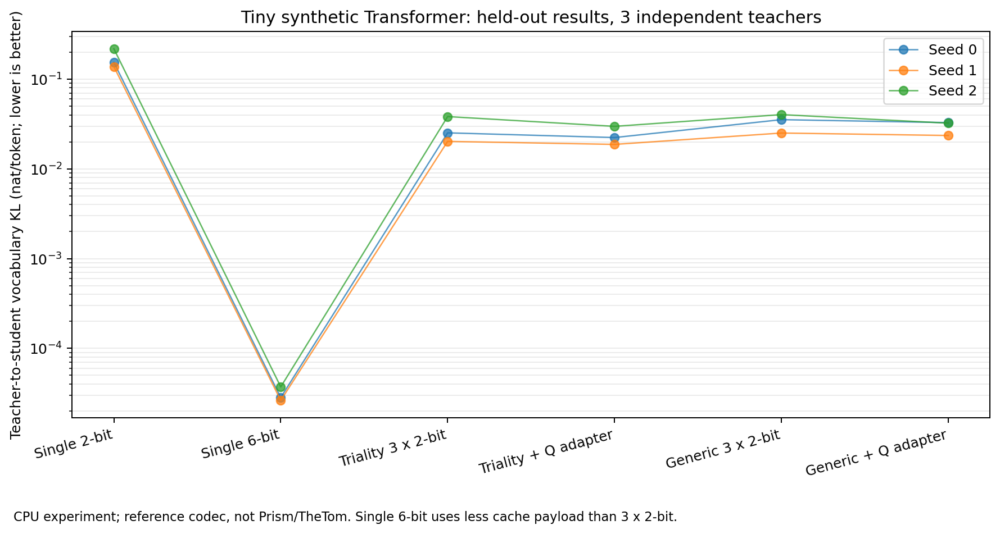

# Synthetic triality PoC: research context, not model qualification

Figure: the owner-authorised original PoC plot, produced on Linux CPU with a tiny synthetic
autoregressive Transformer and three independently trained teacher seeds (0, 1, 2). This is not
a measurement on the preview Windows PC, Qwen or a 27B Bonsai model. The seed is the replicate;
token positions are not independent replicates. Lower teacher-relative KL is better.

The original single-six-bit arm has mean KL 0.0000306145, compared with 0.0279132 for
three two-bit triality views and 0.0236220 after query-adapter training. Thus the three-view result
does not beat the single-six-bit baseline. The paired trained-query improvement has an exploratory
95% t interval of [-0.00489850, 0.01348077], which includes zero. Three seeds are insufficient for
a robust generalisation claim. No speed or real-model quality benefit follows from this figure.

## Provenance and numerical reproduction

The user's design specification supplied the proposed same-lift Spin(8) views and query adapter.
ChatGPT assisted with the original PoC and analysis, dated 23 October 2026. The original package
reported PyTorch 2.10.0+cpu, Python 3.13.5, 350 teacher steps and 160 adapter steps. These files are
copied unchanged with the owner's permission; no training or new measurement was performed for
this preview. No external paper's text or figures are reproduced.

| Original file | SHA-256 |
| --- | --- |
| `paper/figures/tiny_vocab_kl.png` | `e91fa7c58a88d7419538857a288422e91b2dfc19adbb922d6e974b8adb2cfcd0` |
| `evidence/tiny_lm/results.json` (here `results.json`) | `91b4cc14b4c409e9f9de164739ba5923edc52d03091347c8bb1b34fa00b49b49` |
| `evidence/tiny_lm_summary.csv` | `50047324c719f291e42455d513950c78f434e86afab6558f801955c3dcc9e985` |
| `evidence/summary.json` | `06f39da76d0238c79d105b95b6a3fdd420cb3fcc6037de7759e203736cbea5c1` |

Run `python docs/research/triality-poc/reproduce.py` from the repository to recompute and compare
all table values and the paired interval using the standard library. It prints computed values and
changes no files. This reproduces the numerical aggregation of the original NumPy
`scripts/build_summary.py`; it does not rerun training or reproduce the PNG byte for byte.
The original PNG plotting script was not present in the supplied source package.

Background attribution: [Vaswani et al., Attention Is All You Need](https://arxiv.org/abs/1706.03762)
and [Baez, The Octonions](https://arxiv.org/abs/math/0105155).
Implementation targets are separately attributed in the repository:
[PrismML-Eng/llama.cpp](https://github.com/PrismML-Eng/llama.cpp),
[TheTom/llama-cpp-turboquant](https://github.com/TheTom/llama-cpp-turboquant), and
[TheTom/turboquant_plus](https://github.com/TheTom/turboquant_plus).
These links give context; they do not imply endorsement or qualification of this preview.
